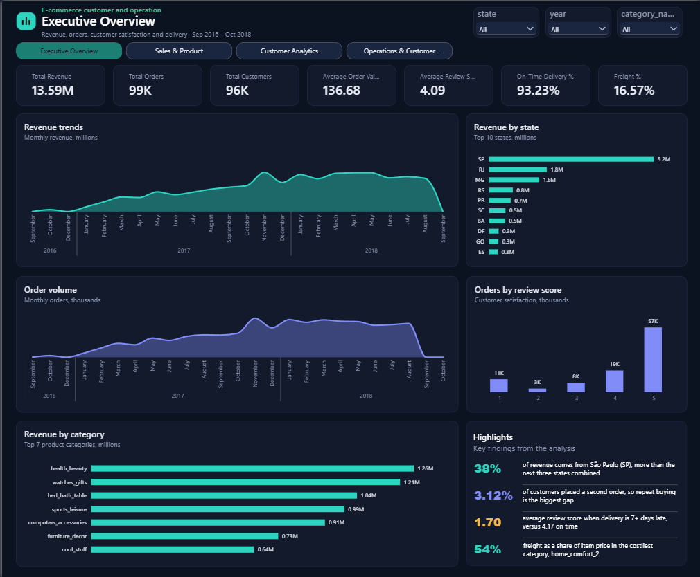
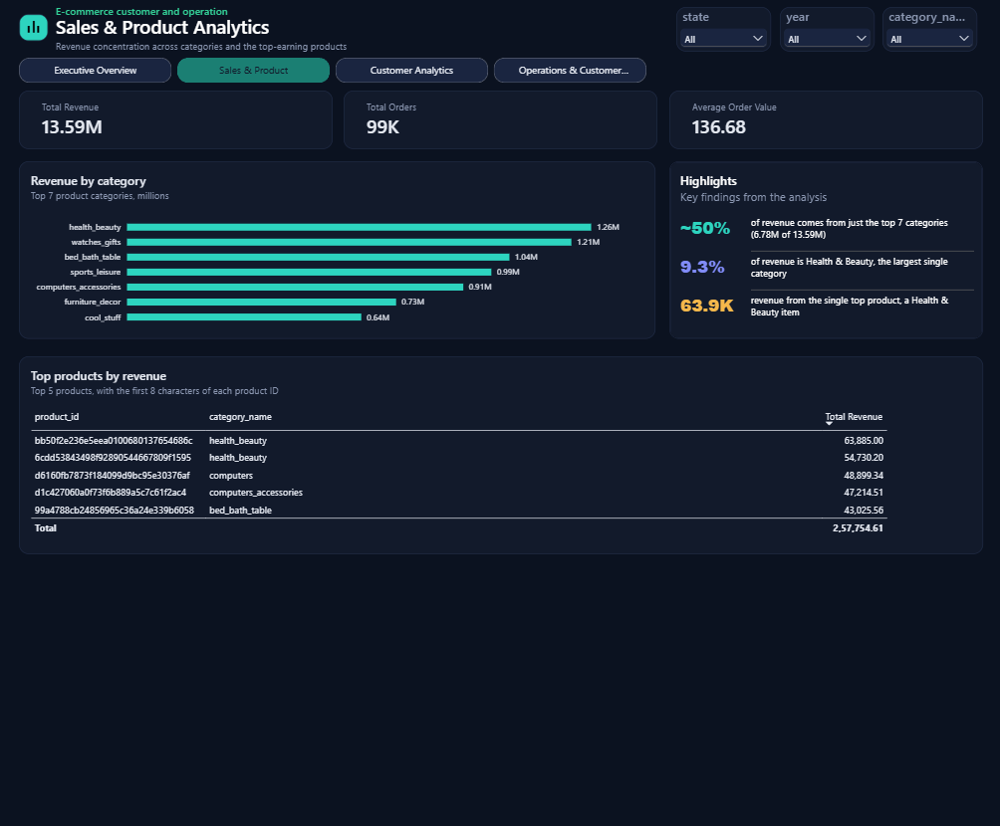
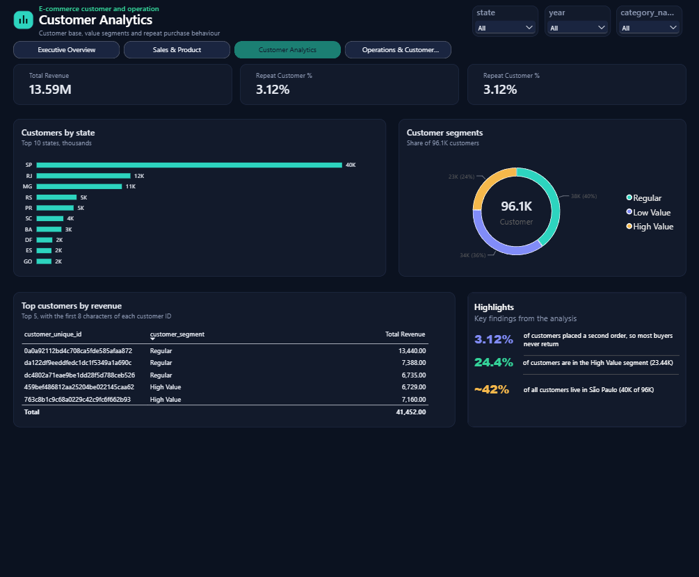
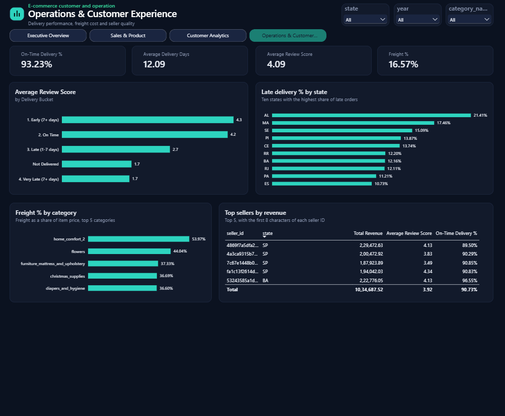

# E-Commerce Customer & Operations Intelligence

End-to-end analysis of ~100,000 orders from a Brazilian online marketplace (Olist, Sep 2016 – Oct 2018): a PostgreSQL star schema, 21 SQL analyses, Python data auditing and statistical testing, and a 4-page Power BI dashboard, written up as findings and recommendations for management.

**Tools:** PostgreSQL · SQL (CTEs, window functions) · Python (Pandas, SciPy, Matplotlib) · Power BI · DAX

## Business questions

1. **Sales:** what is driving revenue, and where is the business performing poorly?
2. **Customers:** who are the valuable customers, and what influences satisfaction and retention?
3. **Operations:** how do delivery performance, freight cost and sellers affect the customer experience?

## Headline results

| Metric | Value |
|---|---|
| Revenue (merchandise, excl. freight) | R$13.59M |
| Orders | 99,441 |
| Unique customers | 96,096 |
| Average order value | R$136.68 |
| Average review score | 4.09 / 5 |
| On-time delivery (delivered orders) | 93.23% |
| Freight as % of item value | 16.57% |
| Customers who ordered more than once | 3.12% |

## Key findings

- **Late delivery is where satisfaction is lost, and the effect is a cliff, not a slope.** Average review score is 4.31 for orders arriving 7+ days early, 4.17 on time, 2.71 up to a week late and 1.70 more than a week late. Kruskal-Wallis (H = 9,990, p < 0.001) and Spearman correlation (rho = -0.18, p < 0.001) on 95,824 orders agree. Rho is modest because about 93% of orders sit in the flat region where timing barely matters.
- **Repeat buying is rare.** Only 3.12% of customers placed a second order, so first-order experience matters more than loyalty mechanics.
- **São Paulo dominates:** about 38% of revenue, more than the next three states combined.
- **Freight burden varies widely by category**, from a 16.57% average to over 50% in the highest category. Small categories need care: percentages there rest on few orders.

Full write-up with recommendations: [docs/findings_and_recommendations.md](docs/findings_and_recommendations.md)

## Dashboard

**Executive Overview**


**Sales & Product**


**Customer Analytics**


**Operations & Customer Experience**


## Data quality issues found and handled

| Issue | What I did |
|---|---|
| `customer_id` is generated per order, not per person (99,441 IDs but only 96,096 real customers) | Keyed the customer dimension on `customer_unique_id`; otherwise repeat-purchase rate would read ~0% |
| 261,831 of 1,000,163 geolocation rows (26%) are exact duplicates, with several coordinates per zip code | Collapsed to one row per zip prefix before any join |
| Orders can have several items, payments and reviews | Kept item-level and order-level data in separate fact tables; aggregated payments and kept the latest review per order |
| 610 products have no category; 2 categories have no English translation | Fell back to the Portuguese name, then `unknown`, instead of dropping rows |
| **On-time delivery KPI overstated by ~3 points in Power BI (96.30% vs 93.23%)** | Caught by recomputing the KPI independently in Python. DAX treated blank delivery dates as 0 in a `<= 0` test, counting undelivered orders as on time. Fixed in the measure |
| **Customer segmentation produced arbitrary tiers** | First version let "ordered once" override spend, labelling big one-time spenders "One-Time". Second version scored Frequency in five equal groups although ~97% of customers have exactly one order, which splits identical customers randomly. Final version scores Recency and Monetary only, with deterministic tie-breaks |
| A category with R$283 revenue showed a 2.5 average review | Added order count as bubble size on the revenue-vs-review chart so tiny samples are visibly small |
| Last months of the dataset are incomplete, so trend lines fall to zero | Documented; not read as a business decline |

## Repository structure

```
sql/
  01_data_foundation_star_schema.sql   load 9 raw CSVs, build 2 fact + 5 dimension tables
  02_analytics_queries.sql             21 business-question queries (window functions, RFM, Pareto)
  03_customer_segments.sql             Recency + Monetary segmentation table for Power BI
python/
  01_data_audit.py                     missing values, duplicates, types, key checks
  02_data_preparation.py               clean order-level and item-level tables
  03_eda_charts.py                     distributions of revenue, delivery time, freight, reviews
  04_statistical_tests.py              Spearman and Kruskal-Wallis: delivery delay vs review score
powerbi/
  dax_measures.txt                     12 measures and 1 calculated column
docs/
  findings_and_recommendations.md      findings, recommendations, limitations
images/                                dashboard screenshots
```

## Data model

Two fact tables (`fact_orders` at order grain, `fact_order_items` at item grain) joined to `dim_customers`, `dim_products`, `dim_sellers` and `dim_date`, plus a one-to-one `customer_segments` table. Keeping the two facts separate avoids double-counting order-level values on multi-item orders.

## How to reproduce

1. Download the dataset: [Brazilian E-Commerce Public Dataset by Olist (Kaggle)](https://www.kaggle.com/datasets/olistbr/brazilian-ecommerce). The raw data is not included here (file size and the dataset's own licence terms).
2. **PostgreSQL:** run `sql/01_data_foundation_star_schema.sql` (set your CSV paths), then `sql/03_customer_segments.sql`. Run the queries in `sql/02_analytics_queries.sql` one at a time.
3. **Python:** in Google Colab, mount Google Drive with the CSVs in a folder named `olist_project`, then run the four scripts in order within one session.
4. **Power BI:** export the clean tables to CSV and load them, create the relationships, mark `dim_date` as the date table, set the `fact_order_items` to `fact_orders` relationship to filter both ways, then add the measures from `powerbi/dax_measures.txt`. The `.pbix` file is not included because it embeds the dataset.

## Limitations

- Delivery and satisfaction are **associated**, which does not prove lateness causes low reviews. Late orders may differ in other ways (remote states, certain sellers or categories) that the tests do not control for.
- The tests cover delivered orders that received a review; orders that never arrived are outside them.
- Segment cut-offs (8 and 5 on a 2–10 scale) are a judgement call.
- Delivery timing is recorded per order, so on multi-seller orders each seller shares the same delivery outcome.

## Data source

Olist Brazilian E-Commerce Public Dataset, published on Kaggle. See the dataset page for licence terms.
